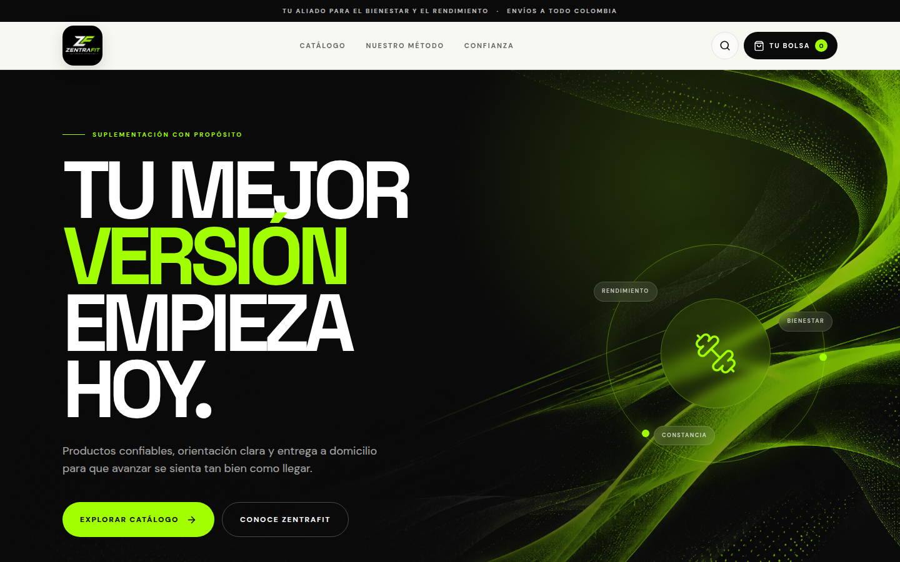
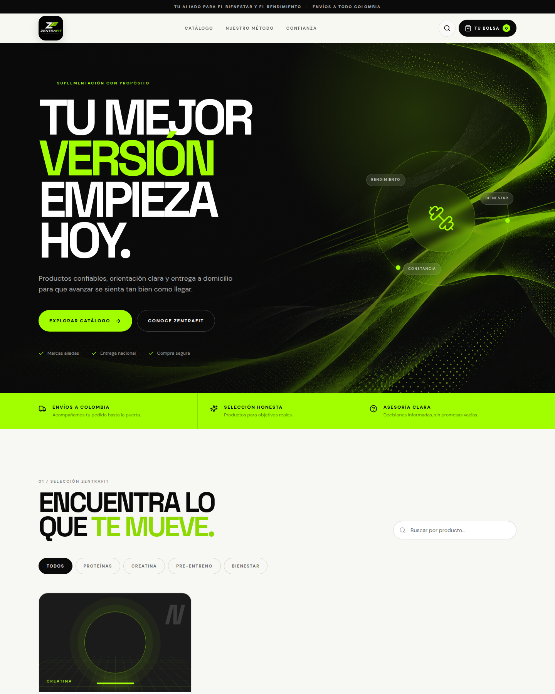
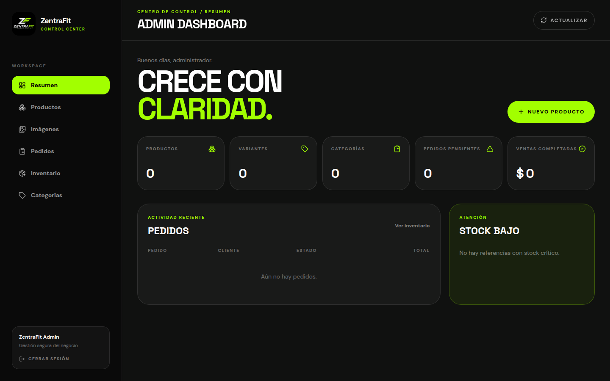

# Manual de usuario de ZentraFit

## Vista visual de la aplicación

Las siguientes capturas corresponden al frontend integrado del repositorio. La tienda usa la identidad visual neon green, negro y blanco; el dashboard usa una interfaz oscura orientada a la gestión operativa.

### Storefront y página de inicio



La página inicial presenta el mensaje de marca, acceso al catálogo, buscador, filtros por categoría y la bolsa de compra. El botón **Explorar catálogo** lleva a la sección de productos.

### Catálogo y selección de productos



En el catálogo se revisan las tarjetas de productos, presentación, precio, imágenes y botón **Añadir**. Cuando el backend devuelve varias imágenes, las flechas e indicadores permiten recorrer la galería.

### Dashboard administrativo



El dashboard concentra el resumen, productos, imágenes, pedidos, inventario y categorías. La captura muestra el estado vacío inicial; al conectar Django aparecerán las métricas y registros reales.

## 1. Iniciar la aplicación

### Backend Django

Desde la raíz del proyecto:

```bash
source .venv/bin/activate
python manage.py migrate
python manage.py runserver 0.0.0.0:8000
```

Abre el administrador nativo en `https://TU-URL-8000/admin/` e inicia sesión con un usuario con permisos `staff`.

### Frontend React

En otra terminal:

```bash
cd frontend
pnpm install
pnpm dev --host 0.0.0.0 --port 3000
```

Usa la URL pública del puerto 3000. La tienda está en `/` y el dashboard visual en `/admin-dashboard`.

## 2. Configuración del frontend

Crea `frontend/.env.local`:

```env
VITE_DJANGO_BASE_URL=https://TU-URL-DEL-PUERTO-8000.app.github.dev
VITE_PREVIEW_MODE=false
VITE_WHATSAPP_NUMBER=573001234567
```

Después de modificarlo, detén y vuelve a iniciar Vite. No publiques este archivo si contiene valores privados.

- Usa `VITE_PREVIEW_MODE=true` únicamente para revisar el diseño sin operaciones reales.
- Usa `VITE_PREVIEW_MODE=false` para consultar Django, guardar carrito y crear pedidos.
- Escribe `VITE_WHATSAPP_NUMBER` en formato internacional, sin `+` ni espacios.

## 3. Preparar el catálogo

El orden recomendado es:

1. Entra al dashboard visual y abre **Categorías**.
2. Crea una categoría con nombre y descripción.
3. Abre **Productos** y crea el producto seleccionando la categoría.
4. Abre **Variantes** y registra SKU, sabor, tamaño, unidad, precio y estado activo.
5. Abre **Inventario** y registra una entrada inicial.
6. Comprueba que el stock calculado sea superior a cero.
7. Verifica el producto en la tienda pública.

El frontend solo muestra productos y variantes activos. Si un producto no aparece, revisa ambos estados y el resultado de `GET /api/catalog/`.

## 4. Subir imágenes

1. Abre `/admin-dashboard` en la URL del frontend.
2. Selecciona la pestaña **Imágenes**.
3. Elige el producto.
4. Selecciona un archivo de imagen.
5. Indica el orden, por ejemplo `0` para la primera imagen.
6. Marca **Imagen principal** si debe aparecer primero en las cards.
7. Pulsa **Subir imagen**.
8. Repite el proceso para añadir otras vistas del producto.

El backend recibe el archivo mediante `multipart/form-data` y lo guarda en `media/productos/`. La asociación se procesa por `ProductoServicio`, manteniendo la arquitectura MVC.

Para revisar una galería:

1. Abre la tienda.
2. Busca el producto.
3. Usa las flechas o indicadores de la card.
4. Pulsa **Ver detalle** para abrir `/producto/<id>`.
5. En la vista de detalle, selecciona miniaturas y una variante antes de añadir al carrito.

## 5. Recibir un pedido

1. El cliente añade una variante al carrito.
2. Pulsa **Continuar compra**.
3. Completa nombre, apellido, correo, teléfono, dirección y ciudad.
4. Selecciona el medio de pago informativo.
5. Pulsa **Crear pedido**.
6. Django crea el pedido con pago `Pendiente` y estado inicial **Por confirmar**.
7. El frontend abre WhatsApp con el número de pedido y los datos completos.
8. El administrador confirma manualmente disponibilidad, entrega y pago por WhatsApp.

La redirección no procesa pagos electrónicos. El total válido es el calculado por Django, incluyendo el costo de envío.

## 6. Revisar pedidos en el dashboard

1. Abre `/admin`.
2. Entra a **Pedidos**.
3. Revisa número, fecha, cliente, correo, ciudad, productos, cantidades y total.
4. Usa la acción de estado cuando corresponda a la lógica disponible.
5. Conserva el número de pedido para la conversación de WhatsApp.

Un error 403 indica normalmente que la sesión no es de un usuario `staff`. Inicia sesión en el Django Admin del puerto 8000 y vuelve a abrir el dashboard.

## 7. Factura básica

El dashboard muestra botones **Generar factura** y **Enviar al correo**, pero el backend todavía debe implementar:

```text
POST /api/admin/orders/<id>/invoice/
POST /api/admin/orders/<id>/invoice/send/
```

Cuando esos endpoints estén disponibles, la factura inicial puede incluir número, fecha, datos del cliente, productos, cantidades, subtotal, envío y total. Debe considerarse un documento interno hasta validar la información contable y los requisitos legales; no asumir que es una factura electrónica DIAN.

## 8. Problemas frecuentes

### No carga el catálogo

- Verifica que Django esté ejecutándose.
- Revisa `VITE_DJANGO_BASE_URL`.
- Abre directamente `/api/catalog/`.
- Revisa la terminal de Django.
- Ejecuta `python manage.py check`.

### Aparece `Failed to fetch`

- Reinicia Vite después de cambiar variables.
- Comprueba CORS y CSRF para las URLs reales de Codespaces.
- Confirma que el backend y frontend estén en puertos públicos.
- Para el dashboard, confirma la sesión `staff`.

### No aparece una imagen

- Comprueba que el archivo se haya guardado en `media/`.
- Abre la URL de la imagen directamente.
- Revisa `MEDIA_ROOT`, `MEDIA_URL` y `urlpatterns`.
- Consulta que la API incluya `imageUrl` o `images`.

### No aparece un producto

Debe tener producto activo, variante activa, precio válido y stock registrado según las reglas actuales del backend.

## 9. Respaldos

Antes de hacer `pull`, cambiar de Codespace o migrar el proyecto, respalda:

```text
db.sqlite3
media/
```

`db.sqlite3` contiene productos, pedidos e inventario. `media/` contiene las imágenes subidas. Ambos están excluidos de Git para evitar pérdidas o sobrescrituras.
